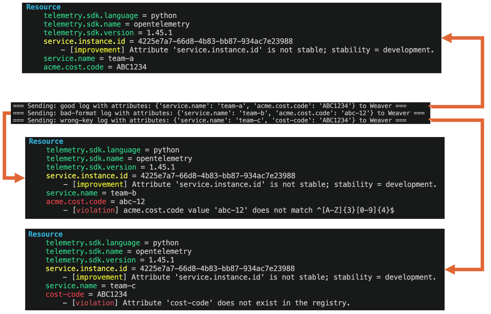

# Hands on with OpenTelemetry Weaver

> Weaver is a way to ensure your telemetry "looks right" and to give developers, SREs and teams a common language and set of tooling to make this easy enterprise-wide.

In this demo we imagine that we work for the `ACME Corporation` and we want to define a new standard attribute across our organisation to represent a `cost code`. Our organisation mandates that this cost code be present on every telemetry record so that we can efficiently cross charge storage costs by cost centre. Furthermore, our organisation mandates that every cost code has the syntax: `[UPPERCASE_ALPHA]{3}[NUMBERS][4]` for example: `ABC1234`.

That's easy to say, harder to do in a large enterprise:

- How does ACME Corp define this rule in a place that everyone can access? Word of mouth? A word doc on Sharepoint? A company wide email?
- How does ACME Corp make it easier for teams to adopt this standard?
- How does ACME Corp make it easy for teams to "self-audit" to ensure their own telemetry is in compliance with the org policy?
- How does ACME Corp ensure that standards don't slip after a while?

The answer is to define a standard convention that the entire company agrees upon in an easily digestible format and provide tooling so teams can audit their own telemetry to ensure they're up to standard.

This is what the OpenTelemetry Weaver project offers.

## Prerequisites

You'll need Python and Docker installed (or equivalent so you can run `docker ps`).

## Next steps

1. [Get started](get-started.md): clone the repo and run Weaver
2. [Interpret the output](interpreting-output.md): understand what Weaver tells you
3. [How it works](how-it-works.md): see how the conventions and policy are defined
