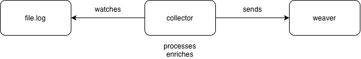

# Checking log files (Part 2)

In [Part 1](get-started.md) a Python script sent perfectly structured telemetry straight to Weaver. Real applications often just write text lines to a file. This part shows how to check those.

Weaver can't read log files itself, but a Collector can: `filelog` receiver → `otlp` exporter → Weaver's OTLP listener.



In this scenario a user writes a log line to a file. Weaver rejects it because it isn't parsed into OTEL and ACME attributes. You then restart the Collector with a config that does the parsing, and Weaver accepts the next line.

!!! note "Registry location"
    The registry (`manifest.yaml`, `model/`) lives in `model/` so that Weaver doesn't try to load the Collector configs or `mkdocs.yml` as semantic convention files. All commands use `-r /work/model`.

## Terminal 1: Weaver

```bash
docker run --rm -v "$(pwd)":/work -w /work -p 4317:4317 -p 4320:4320 otel/weaver registry live-check -r /work/model --advice-policies /work/policies --otlp-grpc-address 0.0.0.0 --inactivity-timeout 120
```

Wait for `OTLP gRPC listener started`. Loading the registry can take a while the first time.

## Terminal 2: Collector v1 (no parsing)

```bash
: > filelog/logs/app.log
docker run --rm --name col -v "$(pwd)/filelog":/cfg -v "$(pwd)/filelog/logs":/logs otel/opentelemetry-collector-contrib:latest --config /cfg/collector-v1.yaml
```

## Terminal 3: write a log line

```bash
echo 'INFO HTTP GET 200 OK /someEndpoint 201.0.100.2 cost.code=ABC12345' >> filelog/logs/app.log
```

The line is shipped as an unparsed body. The log record has no `acme.cost.code` attribute, so Weaver reports:

```text
Log
    - [violation] Log record is missing required attribute 'acme.cost.code'
    log.file.name = app.log
```

## Fix it: Collector v2 (parses the line)

Stop the Collector in Terminal 2 (`Ctrl+C`) and start it with [collector-v2.yaml](https://github.com/agardnerIT/otel-weaver-hands-on/blob/main/filelog/collector-v2.yaml):

```bash
docker run --rm --name col -v "$(pwd)/filelog":/cfg -v "$(pwd)/filelog/logs":/logs otel/opentelemetry-collector-contrib:latest --config /cfg/collector-v2.yaml
```

It uses a `regex_parser` to turn the line into attributes, all on the log record, just like the Python script in Part 1:

| Log text | Attribute | Where |
|---|---|---|
| `GET` | `http.request.method` | Log record |
| `200` | `http.response.status_code` (int) | Log record |
| `/someEndpoint` | `url.path` | Log record |
| `201.0.100.2` | `client.address` | Log record |
| `cost.code=...` | `acme.cost.code` | Log record |

Now write a second line. Note the cost code has **four** digits. `ABC12345` (five digits) would still violate the `^[A-Z]{3}[0-9]{4}$` rule, so try that too once you've seen the green result.

```bash
echo 'INFO HTTP GET 200 OK /someEndpoint 201.0.100.2 cost.code=ABC1234' >> filelog/logs/app.log
```

Weaver now shows no violations:

```text
Log
    log.file.name = app.log
    client.address = 201.0.100.2
    acme.cost.code = ABC1234
    http.request.method = GET
    http.response.status_code = 200
    url.path = /someEndpoint
```

The only advice left is an `improvement` that `log.file.name` isn't stable yet. That is informational, not a failure.

## Gotchas

- Weaver's OTLP listener doesn't accept gzip, so the Collector's exporter sets `compression: none`.
- The configs use `start_at: end`, so only lines appended after the Collector starts are read. A restart won't re-send old lines.
- `host.docker.internal` lets the Collector container reach Weaver's published port on the host.
